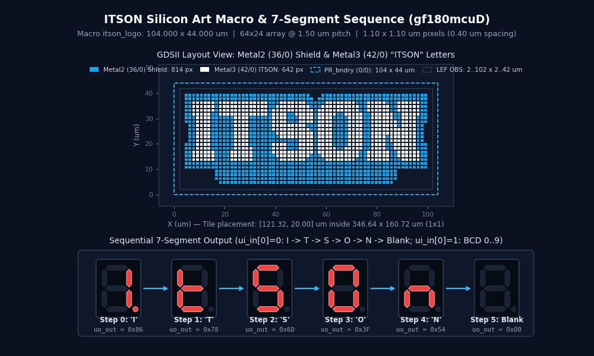

<!---

This file is used to generate your project datasheet. Please fill in the information below and delete any unused
sections.

You can also include images in this folder and reference them in the markdown. Each image must be less than
512 kb in size, and the combined size of all images must be less than 1 MB.
-->

## How it works

**ITSON 7-Seg BCD & Silicon Art** combines a physical on-die **ITSON institutional silicon art macro** with a sequential **`I-T-S-O-N` & numeric BCD 7-segment display driver**, targeting **Tiny Tapeout `gf180mcuD` (`1x1` tile: `346.64 × 160.72 µm`)**.

### 1. ITSON Physical Silicon Art Macro (`itson_logo`)
- Instantiated directly in RTL as a preserved blackbox macro (`(* keep *) itson_logo logo ();`) and placed at `(121.32, 20.0) µm` inside the `1x1` tile (`104.0 × 44.0 µm` bounding box).
- Encodes the **64×24** ITSON institutional emblem on a `1.50 µm` grid using discrete `1.10 × 1.10 µm` metal squares (`0.40 µm` spacing to satisfy GF180MCU min width/spacing and avoid wide-metal slotting rules):
  - **Shield background:** `Metal2` (GDS layer `36`, datatype `0`)
  - **`"ITSON"` slab-serif lettering:** `Metal3` (GDS layer `42`, datatype `0`), oriented right-side-up (`+Y`) for optical die inspection under a microscope.

### 2. Sequential `I-T-S-O-N` & Numeric BCD 7-Segment Driver
- **23-bit Programmable Clock Divider (`div_cnt[22:0]`):** Generates `step_pulse` every `2^13`, `2^16`, `2^20`, or `2^23` clock cycles (selected by `ui_in[2:1]`), or every `4` clock cycles in Turbo / testbench mode (`ui_in[7] = 1`).
- **Dual-Mode Counter (`bcd_cnt[3:0]`):**
  - **ITSON Wordmark Mode (`ui_in[0] = 0`):** Cycles `0 → 5 → 0` displaying **`I`** (`0x06`), **`t`** (`0x78`), **`S`** (`0x6D`), **`O`** (`0x3F`), **`n`** (`0x54`), and **blank** (`0x00`). Switching from numeric mode while `bcd_cnt >= 5` wraps cleanly back to `0` on the next step.
  - **Numeric BCD Mode (`ui_in[0] = 1`):** Cycles `0 → 9 → 0` displaying standard 7-segment digits `0`–`9`.
- **Decimal Point (`uo_out[7]`):** Asserted (`1`) whenever `active_bcd == 0` to mark the start of the `I-T-S-O-N` or `0–9` sequence (`0x86` for `I`, `0xBF` for `0`).
- **Pause & Manual Override:**
  - `ui_in[6] = 1` freezes `div_cnt` and `bcd_cnt`.
  - `ui_in[3] = 1` bypasses `bcd_cnt` and drives `active_bcd` directly from `uio_in[3:0]` (when non-zero) or `{1'b0, ui_in[6:4]}`.
- **Telemetry (`uio_out[7:0]`, `uio_oe = 8'hFF`):** Exposes `{active_bcd[2:0], step_pulse, active_bcd}` for logic analyzers or LEDs.

## How to test

1. Apply a clock on `clk` (recommended `10 kHz` on hardware for ~`0.82 s` per character at `ui_in[2:1] = 2'b00`) and pulse active-low reset (`rst_n = 0`, then `1`).
2. Observe the onboard Tiny Tapeout common-cathode 7-segment display connected to `uo_out[7:0]` (`{DP, G, F, E, D, C, B, A}`).
3. Configure behavior using the 8 input DIP switches (`ui_in[7:0]`):

| Pin | Signal | Function |
| :--- | :--- | :--- |
| `ui_in[0]` | `MODE_BCD` | `0`: sequential `I-t-S-O-n- ` wordmark, `1`: numeric BCD `0–9` |
| `ui_in[2:1]` | `SPEED[1:0]` | Divider select when `ui_in[7]=0`: `00` = `2^13`, `01` = `2^16`, `10` = `2^20`, `11` = `2^23` |
| `ui_in[3]` | `MANUAL_EN` | `1`: manual index override (`uio_in[3:0]` if non-zero, else `{1'b0, ui_in[6:4]}`) |
| `ui_in[5:4]` | `MAN_BCD[1:0]` | Lower 2 bits of switch-based manual BCD value when `ui_in[3]=1` |
| `ui_in[6]` | `PAUSE_MAN2` | In auto mode: `1` pauses stepping; in manual mode (`ui_in[3]=1`): MSB (`[2]`) of manual BCD |
| `ui_in[7]` | `TURBO_SIM` | `1`: turbo / simulation mode (`step_pulse` every 4 clock cycles) |

4. Pinout summary for outputs and bidirectional telemetry:

| Pins | Signal | Description |
| :--- | :--- | :--- |
| `uo_out[6:0]` | `SEG_G..SEG_A` | Active-high common-cathode segments `{g, f, e, d, c, b, a}` |
| `uo_out[7]` | `DP` | Decimal point (`1` when `active_bcd == 0`, else `0`) |
| `uio_out[3:0]` | `BCD[3:0]` | Current `active_bcd` value (`0..9` or `0..5`) |
| `uio_out[4]` | `STEP_TICK` | High for 1 clock cycle right before `bcd_cnt` increments |
| `uio_out[7:5]` | `IDX[2:0]` | Mirror of `active_bcd[2:0]` |

## External hardware

- **Tiny Tapeout Demo Board:** Built-in 7-segment display (`uo_out[7:0]`), DIP switches (`ui_in[7:0]`), and clock/reset generator.
- Optional: LED bar or logic analyzer on `uio_out[7:0]` to inspect `BCD[3:0]`, `STEP_TICK`, and `IDX[2:0]`.
